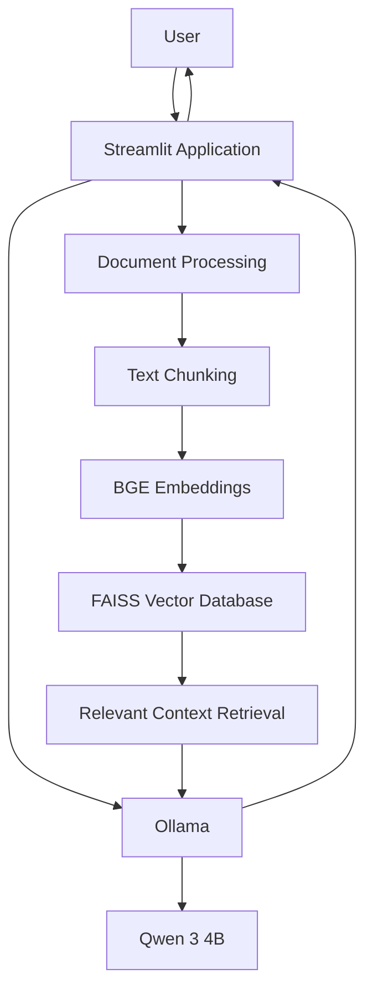
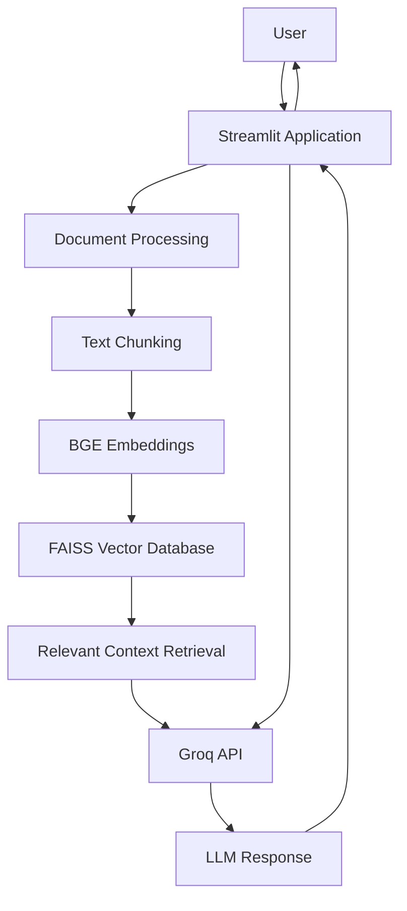

# DocuMind AI

**DocuMind AI** is an AI-powered document intelligence application that combines ATS-style resume evaluation, document comparison, and Retrieval-Augmented Generation (RAG) question answering.

It supports two language-model configurations:

- **Local mode:** Ollama with Qwen 3 4B.
- **Cloud mode:** Groq API with GPT-OSS 120B.

The application is designed to assist document review and analysis while keeping the user in control of final decisions.

---

## 📋 Table of Contents

- [Features](#-features)
- [System Architecture](#-system-architecture)
  - [Local Architecture — Ollama](#local-architecture--ollama)
  - [Cloud Architecture — Groq](#cloud-architecture--groq)
- [RAG Implementation](#-rag-implementation)
  - [RAG Pipeline](#rag-pipeline)
  - [Mathematical Foundation](#mathematical-foundation)
- [ATS Evaluation Methodology](#-ats-evaluation-methodology)
  - [Weighted Scoring Model](#weighted-scoring-model)
  - [Evaluation Labels](#evaluation-labels)
- [Technology Stack](#-technology-stack)
- [Installation and Setup](#-installation-and-setup)
- [Responsible AI and Limitations](#-responsible-ai-and-limitations)
- [Project Status](#-project-status)

---

## ✨ Features

- **ATS Resume Evaluation:** Evaluates resumes against a job description, highlighting matching skills, experience, missing requirements, and estimated candidate fit.
- **Document Comparison:** Compares uploaded documents and identifies similarities and differences.
- **RAG-Based Q&A:** Answers questions using relevant information retrieved from uploaded documents.
- **Local and Cloud AI Support:** Switch between Ollama and Groq through environment configuration.
- **Semantic Search:** Uses embeddings and FAISS for retrieving relevant document chunks.

---

## 🏗️ System Architecture

### 1. Local Architecture — Ollama

In local mode, language-model inference runs on the user's machine through Ollama.



**Workflow:**

1. The user uploads documents through the Streamlit interface.
2. Text is extracted and divided into chunks.
3. BGE generates vector embeddings.
4. FAISS stores and retrieves relevant document chunks.
5. Ollama runs Qwen 3 4B to generate responses.

### 2. Cloud Architecture — Groq

In cloud mode, the application uses Groq for language-model inference.



**Workflow:**

1. The application processes uploaded documents.
2. BGE generates embeddings and FAISS retrieves relevant information.
3. Relevant context is sent to the Groq API when an LLM response is required.
4. Groq generates the response and returns it to the application.

> **Note:** In this architecture, embedding generation and FAISS retrieval remain part of the application runtime. They are not automatically hosted by Groq.

---

## 🧠 RAG Implementation

DocuMind AI uses Retrieval-Augmented Generation (RAG) to answer questions based on uploaded documents.

### RAG Pipeline

1. **Document Extraction:** Extracts text from uploaded files.
2. **Text Chunking:** Splits extracted text into smaller sections.
3. **Embedding Generation:** Converts each chunk into a numerical vector using `BAAI/bge-small-en-v1.5`.
4. **Vector Storage:** Stores normalized embeddings in a FAISS index.
5. **Similarity Search:** Converts the user's question into an embedding and retrieves the five most relevant chunks.
6. **Context Construction:** Combines retrieved chunks into context for the language model.
7. **Answer Generation:** The selected LLM generates an answer using the retrieved context.

### Mathematical Foundation

**1. Cosine Similarity**

Cosine similarity measures how closely two vectors point in the same direction.

\[
\operatorname{Similarity}(q,d)=
\frac{q\cdot d}{\|q\|\times\|d\|}
\]

Where:

- \(q\) = Query embedding
- \(d\) = Document chunk embedding
- \(q\cdot d\) = Dot product of the vectors
- \(\|q\|\) and \(\|d\|\) = Vector magnitudes

Because the embeddings are normalized before indexing, cosine similarity is equivalent to their inner product:

\[
\boxed{\operatorname{Similarity}(q,d)=q\cdot d}
\]

A higher similarity indicates a closer semantic match between the question and a document chunk.

**2. Top-K Retrieval**

The retrieval system selects the \(k\) chunks with the highest similarity scores:

\[
\mathcal{R}_k(q)=
\operatorname{TopK}_{d_i\in\mathcal{D}}
\left(\operatorname{Similarity}(q,d_i)\right)
\]

Where:

- \(\mathcal{D}\) = Collection of document chunks
- \(q\) = User query
- \(k\) = Number of chunks retrieved

**Current configuration:** \(k=5\).

---

## 📊 ATS Evaluation Methodology

The ATS module evaluates each resume against a given job description.

It considers five major dimensions:

| Evaluation Criteria | Weight |
|---|---:|
| Technical and Job-Related Skills | 40% |
| Relevant Experience | 25% |
| Preferred Skills | 15% |
| Education and Certifications | 10% |
| Projects and Achievements | 10% |

### Weighted Scoring Model

The evaluation framework is represented by the following weighted formula:

\[
\boxed{
                  S =0.40T+0.25E+0.15P+0.10C+0.10A
}
\]

Where:

| Variable | Meaning |
|---|---|
| \(S\) | Overall candidate fit score |
| \(T\) | Technical and job-related skills |
| \(E\) | Relevant experience |
| \(P\) | Preferred skills |
| \(C\) | Education and certifications |
| \(A\) | Projects and achievements |

Each component is assessed on a scale of 0–100.

If a category is not applicable, the evaluator is instructed to redistribute the weights proportionally.

### Evaluation Labels

The system uses evidence-oriented labels:

- **MATCHED:** Requirement is supported by the resume.
- **PARTIALLY MATCHED:** Some relevant evidence is present, but the requirement is not fully demonstrated.
- **NOT FOUND:** No supporting evidence was identified.
- **UNCLEAR:** Available information is insufficient to determine a match.

> **Implementation note:** The current implementation instructs the language model to apply this weighted rubric and generate an estimated fit score. The formula describes the evaluation framework; it is not currently calculated by a deterministic Python scoring function. Scores should therefore be treated as AI-generated estimates and reviewed alongside the supporting evidence.

The ATS module is intended to support human decision-making, not replace recruiters or make automatic hiring decisions.

---

## 🛠️ Technology Stack

| Component | Technology |
|---|---|
| Frontend | Streamlit |
| Programming Language | Python |
| Local LLM Runtime | Ollama |
| Local Language Model | Qwen 3 4B |
| Cloud LLM Provider | Groq |
| Cloud Language Model | GPT-OSS 120B |
| Embedding Model | BAAI/bge-small-en-v1.5 |
| Vector Database | FAISS |
| Configuration | Python environment variables |

---

## 🚀 Installation and Setup

### 1. Clone the Repository

```bash
git clone <your-repository-url>
cd DOCUMIND_AI
```

### 2. Create a Virtual Environment

```bash
python -m venv .venv
```

Activate it on Windows:

```powershell
.venv\Scripts\Activate.ps1
```

### 3. Install Dependencies

```bash
pip install -r requirements.txt
```

### 4. Configure Environment Variables

Create a `.env` file using `.env.example` as a template.

**For local Ollama mode:**

```env
AI_PROVIDER=ollama
OLLAMA_HOST=http://localhost:11434
OLLAMA_MODEL=qwen3:4b-instruct-2507-q4_K_M
OLLAMA_TIMEOUT=600
```

Make sure Ollama is running and the configured model is available.

**For Groq cloud mode:**

```env
AI_PROVIDER=groq
GROQ_API_KEY=your_groq_api_key
GROQ_MODEL=openai/gpt-oss-120b
```

Keep your actual API key private. Never commit your `.env` file to GitHub.

### 5. Run the Application

```bash
streamlit run app.py
```

Open the local URL displayed in the terminal.

---

## ⚖️ Responsible AI and Limitations

- AI-generated answers may contain inaccuracies. Verify important information against the original documents.
- ATS scores are estimates and should not be used as the sole basis for hiring decisions.
- The system should not infer or evaluate protected personal characteristics.
- Cloud mode sends relevant prompts and document content to the configured LLM provider. Do not upload confidential documents unless authorized.
- Performance depends on the selected model, hardware, provider availability, and document size.

---

## 📈 Project Status

The following workflows have been tested with both the configured local/cloud provider paths:

- ATS Resume Evaluation
- Document Comparison
- RAG-Based Question Answering

Cloud deployment and hosting configuration should be validated separately before public release.

---
## Data and privacy
Uploaded documents are processed by this local app. The FAISS index and extracted chunk text are saved under `data/`. Do not expose the Ollama port to the public internet. Back up `data/` if you want to retain your index.

## Current limitations
- No OCR for scanned PDFs.
- No automatic hiring decisions; ATS output is decision support and requires human verification.
- Very large documents may be truncated for comparison/ATS prompts. RAG is preferred for querying large collections.
- This is a local app. Cloud deployment requires a reachable secured inference service and a separate deployment/security review.

**DocuMind AI — Turning documents into actionable insights.**
